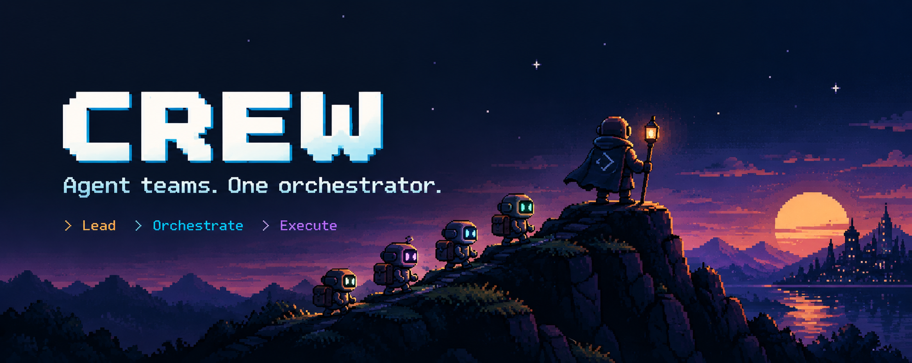
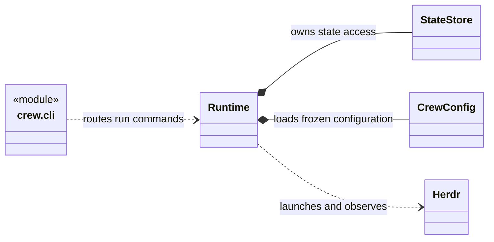

# Crew

Crew runs configured agent teams through Herdr. The Lead supervises work. One Orchestrator advances each run. Workers produce assigned artifacts.
Mutable workers use native Git worktrees. Dispatch and cleanup use saved ownership records.

The designated reviewer accepted the reduced release on 2026-10-10.
Verification used fake Herdr adapters, temporary Git repositories, and real CLI subprocesses.
Live Herdr dispatch and process cleanup remain unverified.

TOON is the default output format in terminals and pipes.
Use `--human` for readable outcomes, paths, and lists. Detailed views retain TOON.
Use `--toon` to select TOON explicitly.
Use `crew update --check` to read published release availability for an installed working checkout.
Use `crew update` to apply that release. See [self-update](docs/runtime-cli.md#explicit-self-update).
See the [CLI output contract](docs/runtime-cli.md).

## Quick installation

Use Python 3.11 or newer and Git. The runtime requires POSIX file locks.
This release has macOS verification. Windows support is unverified.

### Install with an AI assistant

Open an AI coding assistant with terminal access on your computer.
Replace `/path/to/your/project` with your project's folder. Then copy this prompt into the assistant:

```text
Install Crew for this project: /path/to/your/project
Repository: https://github.com/Taimoorkhan1122/crew

I authorize a local Crew installation and its Python dependencies.
You may add Crew to my shell PATH. Preserve existing settings and project files.

1. Check the operating system, Python version, and Git availability.
   Crew requires Python 3.11 or newer and POSIX file locks.
   If a prerequisite is missing, explain how I can install it.
2. Clone Crew into an available source folder, or use an existing checkout.
   Read its AGENTS.md, README.md, and docs/setup.md before installation.
3. Install Crew in the separate environment described in the setup guide.
   Make the crew command available in my shell.
4. Initialize Crew in my project with CREW_ROLE=lead.
   Select the installed templates with --global-dir.
5. Check crew --version and crew --help.
   Validate my project configuration with the installed templates.
   Report the installed version, configuration path, check results, and remaining live-run requirements.

Stop after installation and configuration checks.
Leave live runs and agent authentication for me.
```

For manual installation, use the steps below.

### 1. Install the CLI

Clone the repository. Then run the guided installer:

```sh
git clone https://github.com/Taimoorkhan1122/crew.git
cd crew
bash scripts/install.sh
```

The installer creates a separate environment, installs Crew, links the `crew`
command, and adds the PATH entry for zsh or bash. Use `--yes` for an unattended
run. Read [setup](docs/setup.md#guided-installation) for the options and the
safety rules.

For a manual installation, use these steps in a separate Python environment:

```sh
crew_venv="$HOME/.local/share/crew/venv"
python3 --version
python3 -m venv "$crew_venv"
"$crew_venv/bin/python" -m pip install .
export PATH="$crew_venv/bin:$PATH"

crew --version
crew --help
```

The expected version is `0.1.4`. Installation can download Python dependencies.
Add `export PATH="$HOME/.local/share/crew/venv/bin:$PATH"` to your shell configuration.
New Herdr panes must find `crew`.

### 2. Set up Crew in your project

Choose the folder where you want Crew to work, such as your application's repository.
Replace `/path/to/your/project` below with that folder's path:

```sh
cd "/path/to/your/project"
crew_global_dir="$HOME/.local/share/crew/venv/share/crew"

CREW_ROLE=lead crew --human --global-dir "$crew_global_dir" project init
crew --global-dir "$crew_global_dir" config validate
```

The first Crew command copies templates and prompts into your project and creates `.crew/project.yaml`.
It preserves existing files. The second command checks the configuration.
The `crew_global_dir` value points to the templates installed in step 1.

Open the `.crew/` configuration files to review the agent settings. The bundled roles select Claude and OpenCode.
Before your first run, complete the [live-run setup](docs/setup.md#prerequisites) for Herdr, agent authentication, and model quota.

Then follow [getting started](docs/quickstart.md) for your first readonly run.

## Start here

| Task | Guide |
| --- | --- |
| Install the CLI | [Setup](docs/setup.md) |
| Prepare a readonly task | [Getting started](docs/quickstart.md) |
| Change the implementation | [Development](docs/development.md) |
| Understand module relationships | [Runtime structure](docs/development.md#runtime-structure) |
| Read the accepted scope | [Release scope](docs/remaining-scope.md) |
| Inspect verification evidence | [Acceptance record](docs/release-acceptance.md) |
| Select future work | [Backlog](docs/backlog.md) |
| Find runtime commands | [Runtime reference](docs/runtime-cli.md) |
| Understand configuration | [Configuration](docs/config-migration.md) |
| Understand role responsibilities | [Lead and Orchestrator](docs/lead-orchestrator-workflow.md) |
| Write documentation | [Documentation style](docs/documentation-style.md) |
| Use the Crew agent skill | [Crew skill](docs/crew-skill.md) |

## Operating model

This UML diagram shows the CLI module and the main runtime classes.
Detailed diagrams show [module relationships](docs/development.md#runtime-structure) and [role interactions](docs/lead-orchestrator-workflow.md#run-and-decision-sequence).
Other diagrams show [task states](docs/runtime-cli.md#task-lifecycle), [script controller](docs/runtime-cli.md#script-controller), and [configuration objects](docs/config-migration.md#configuration-model).



Configuration selects CLIs, models, effort, prompts, tools, resource limits, and flows.
A run keeps a fixed configuration. An explicit Orchestrator tick advances the run, or one script controller advances it. Crew has no event subscription service.

Pause and stop use cooperative controls. Close removes resources only when ownership and completion evidence are sufficient.
Active processes, uncertain resources, dirty worktrees, branches, and workspace shells can remain. Runtime output reports them.

Start with the readonly flow. Mutable work requires Git repositories and project-relative paths.
Crew does not execute external push, PR, or merge actions.
