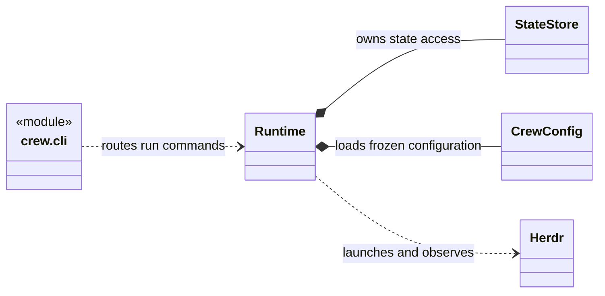

# Crew

Crew runs configured agent teams through Herdr. The Lead supervises work. One Orchestrator advances each run. Workers produce assigned artifacts.
Mutable workers use native Git worktrees. Dispatch and cleanup use saved ownership records.

The designated reviewer accepted the reduced release on 2026-10-10.
Verification used fake Herdr adapters, temporary Git repositories, and real CLI subprocesses.
Live Herdr dispatch and process cleanup remain unverified.

## Start here

| Task | Guide |
| --- | --- |
| Install the CLI | [Setup](docs/setup.md) |
| Prepare a readonly task | [Getting started](docs/quickstart.md) |
| Change the implementation | [Development](docs/development.md) |
| Understand module relationships | [Runtime structure](docs/development.md#runtime-structure) |
| Read the accepted scope | [Release scope](docs/remaining-scope.md) |
| Inspect verification evidence | [Acceptance record](docs/release-acceptance.md) |
| Select future work | [Backlog](docs/backlog.md) |
| Find runtime commands | [Runtime reference](docs/runtime-cli.md) |
| Understand configuration | [Configuration](docs/config-migration.md) |
| Understand role responsibilities | [Lead and Orchestrator](docs/lead-orchestrator-workflow.md) |
| Write documentation | [Documentation style](docs/documentation-style.md) |

## Operating model

This UML diagram shows the CLI module and the main runtime classes.
Detailed diagrams show [module relationships](docs/development.md#runtime-structure) and [role interactions](docs/lead-orchestrator-workflow.md#run-and-decision-sequence).
Other diagrams show [task states](docs/runtime-cli.md#task-lifecycle) and [configuration objects](docs/config-migration.md#configuration-model).

Configuration selects CLIs, models, effort, prompts, tools, resource limits, and flows.
A run keeps a fixed configuration. Explicit Orchestrator tick advances the run. Crew has no event subscription service.

Pause and stop use cooperative controls. Close removes resources only when ownership and completion evidence are sufficient.
Active processes, uncertain resources, dirty worktrees, branches, and workspace shells can remain. Runtime output reports them.

Start with the readonly flow. Mutable work requires Git repositories and project-relative paths.
Crew does not execute external push, PR, or merge actions.
