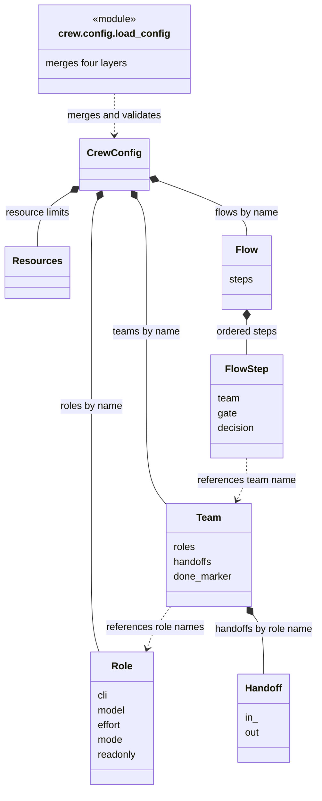

# Crew config and prompt migration

Use [setup](setup.md) for installation. Use [getting started](quickstart.md) for the first run.
This page describes the overlay contract and the legacy migration.
The reduced runtime is independently accepted. See [acceptance details](release-acceptance.md) for the distinction between tests and live behavior.

## Layout

- Source defaults are in `defaults/`. Installed templates are under the installation prefix's `share/crew` directory.
- Global configuration defaults to `~/.config/crew/`. Use `--global-dir` to select another directory. Installation does not populate the user directory.
- Project overrides are in the `.crew/` directory. Editable prompts are in `.crew/prompts/`.
- The loader applies four layers in order: global defaults, project split files, `.crew/project.yaml`, and an explicit run override.
- YAML values select models, CLIs, effort, arguments, permissions, skills, tools, resources, and flows.
- Independent verification covered packaged defaults, prompts, flows, and project initialization that preserves existing files.
- Project prompt paths are relative to `.crew/`.

Angle-bracket and brace values in project commands are templates.
Runtime must replace placeholders with validated run values. Do not send unresolved placeholders to a shell.

## Project split files

The project override uses the same file shapes as the global defaults.
A missing project file inherits the global values. A partial mapping overrides the specified fields only.

| File | Shape |
| --- | --- |
| `.crew/config.yaml` | Top-level settings. |
| `.crew/roles.yaml` | Role-name mappings. No outer `roles` key. |
| `.crew/teams.yaml` | Team-name mappings. No outer `teams` key. |
| `.crew/axis.yaml` | Tool-name mappings. No outer `axis` key. |
| `.crew/flows/<name>.yaml` or `.yml` | One flow definition for that name. |
| `.crew/project.yaml` | Full-schema overlay. It wins over the split files. |

Example split files:

```yaml
# .crew/config.yaml
resources:
  max_workers: 6
```

```yaml
# .crew/roles.yaml
qa-reviewer:
  model: opencode-go/deepseek-v4.1-flash
```

```yaml
# .crew/flows/review.yaml
steps:
  - team: review
max_fail_rounds: 1
```

Merge rules:

- A list replaces the complete list. The loader does not append items.
- A supplied `handoffs` mapping replaces the whole mapping.
- A missing file or a missing field keeps the inherited value.

The file name stem identifies a flow. The loader rejects two files with the same stem in one layer.
The same flow name in different layers is an override.

## Configuration model

The UML diagram shows the loader and the validated objects.
`crew.config.load_config` merges the four layers. It then validates the merged mapping into `CrewConfig`.
Composition means nested configuration objects. Dashed arrows show calls or name references.



The loader applies the layers in this order: global defaults, project split files, `.crew/project.yaml`, run override.
Each later layer overrides the earlier layers. The loader validates the merged result one time.
`run new` saves the merged configuration in `run.yaml`. It records the configuration digest in state.
Run edits are permitted only before start, tasks, or decisions.
Runtime compares the digest before progress. Python field `Handoff.in_` uses YAML key `in`.
The diagram omits AXI, loop, environment, and tracker fields. See the authoritative [schema definitions](../crew/config.py).

## Migration boundaries

Use generic role prompts for triage, reproduction, reporting, implementation, and independent review.
Keep project-specific paths, checks, environment commands, and account values in the project overlay.

Migration does not execute environment commands or authorize external changes.
Tracker access is readonly by default. External writes and protected operations require a user decision.
Frontend browser verification requires an isolated environment and its cleanup procedure.
Missing inputs mean BLOCKED, not PASS.

## Project initialization and pinning

`project init` copies the global templates into `.crew/` without replacing existing files.
The copied split files become the project override. They are active immediately.

Warning: A copied value pins the project against later global changes.
After initialization, a global change does not reach the project for a copied key.
Set the project value in `.crew/`, or remove the copied file, to inherit the global change again.

`run new` freezes the merged configuration. A later project or global change does not change that run.
Create a new run to apply a configuration change.

## Validation and integration

Historical validation accepted global defaults and a project overlay at the configuration layer.
It did not establish compatibility with mutable launches.
The loader rejects duplicate YAML keys and unknown fields. It validates role, team, and flow references.
The loader checks each project split path, including the flows directory and each flow file, for symlinks and path escape.
Models remain configuration values.

See [getting started](quickstart.md) and [runtime reference](runtime-cli.md) for current commands.
Initialization preserves existing files. A run saves a fixed configuration.
After start, create another run for configuration changes. Do not edit fixed files manually.

## Bounded native-worktree configuration

Mutable launches use `repos`, `base_branch`, and `worktree_pattern`.
See the [runtime contract](runtime-cli.md#native-worktree-creation-and-launch).
Repositories must be project-relative exact Git roots.
Worktree paths must stay inside the project. Each lane/repository pair needs a unique path.
The first repository supplies the launch directory.

The default pattern is `.crew/worktrees/{run}/{lane}/{repo}`.
Supported fields are `run`, `lane`, and indexed `repo`.
Legacy overlays can contain absolute repository paths and an absolute `{ticket}` pattern.
Those values fail before mutable launch. Migrate incompatible overlays before mutable dispatch.

Readonly roles can still use projects without Git.
Configuration does not authorize environment commands, cleanup commands, or external actions.
