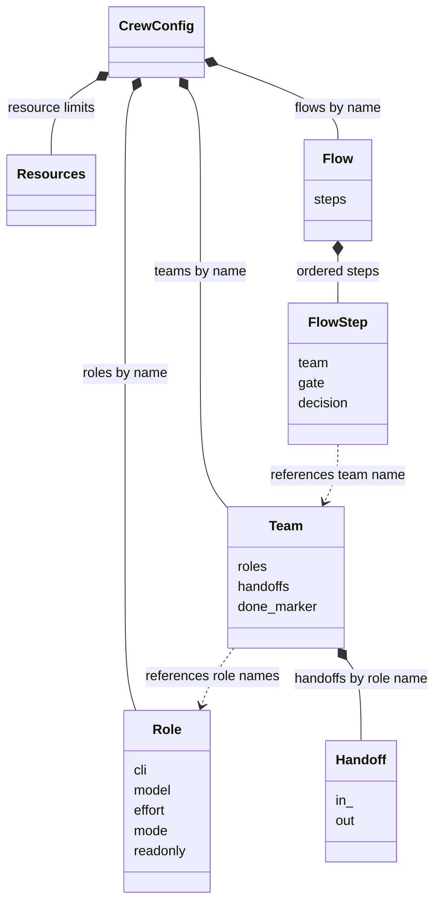

# Crew config and prompt migration

Use [setup](setup.md) for installation. Use [getting started](quickstart.md) for the first run.
This page describes the overlay contract and the legacy migration.
The reduced runtime is independently accepted. See [acceptance details](release-acceptance.md) for the distinction between tests and live behavior.

## Layout

- Source defaults are in `defaults/`. Installed templates are under the installation prefix's `share/crew` directory.
- Global configuration defaults to `~/.config/crew/`. Use `--global-dir` to select another directory. Installation does not populate the user directory.
- Project overrides are in `.crew/project.yaml`. Editable prompts are in `.crew/prompts/`.
- The loader merges global values, project values, and run values in that order.
- YAML values select models, CLIs, effort, arguments, permissions, skills, tools, resources, and flows.
- Independent verification covered packaged defaults, prompts, flows, and project initialization that preserves existing files.
- Project prompt paths are relative to `.crew/`.

Angle-bracket and brace values in project commands are templates.
Runtime must replace placeholders with validated run values. Do not send unresolved placeholders to a shell.

## Configuration model

The UML diagram shows validated objects after overlay merging.
Composition means nested configuration objects. Dashed arrows show names that the loader validates.

Global files supply base values. Project settings override those values. Run edits apply last.
`run new` saves the validated configuration in `run.yaml`. It records the configuration digest in state.
Run edits are permitted only before start, tasks, or decisions.
Runtime compares the digest before progress. Python field `Handoff.in_` uses YAML key `in`.
The diagram omits AXI, loop, environment, and tracker fields. See the authoritative [schema definitions](../crew/config.py).

## Migration boundaries

Use generic role prompts for triage, reproduction, reporting, implementation, and independent review.
Keep project-specific paths, checks, environment commands, and account values in the project overlay.

Migration does not execute environment commands or authorize external changes.
Tracker access is readonly by default. External writes and protected operations require a user decision.
Frontend browser verification requires an isolated environment and its cleanup procedure.
Missing inputs mean BLOCKED, not PASS.

## Validation and integration

Historical validation accepted global defaults and a project overlay at the configuration layer.
It did not establish compatibility with mutable launches.
The loader rejects duplicate YAML keys and unknown fields. It validates role, team, and flow references.
Models remain configuration values.

See [getting started](quickstart.md) and [runtime reference](runtime-cli.md) for current commands.
Initialization preserves existing files. A run saves a fixed configuration.
After start, create another run for configuration changes. Do not edit fixed files manually.

## Bounded native-worktree configuration

Mutable launches use `repos`, `base_branch`, and `worktree_pattern`.
See the [runtime contract](runtime-cli.md#native-worktree-creation-and-launch).
Repositories must be project-relative exact Git roots.
Worktree paths must stay inside the project. Each lane/repository pair needs a unique path.
The first repository supplies the launch directory.

The default pattern is `.crew/worktrees/{run}/{lane}/{repo}`.
Supported fields are `run`, `lane`, and indexed `repo`.
Legacy overlays can contain absolute repository paths and an absolute `{ticket}` pattern.
Those values fail before mutable launch. Migrate incompatible overlays before mutable dispatch.

Readonly roles can still use projects without Git.
Configuration does not authorize environment commands, cleanup commands, or external actions.
