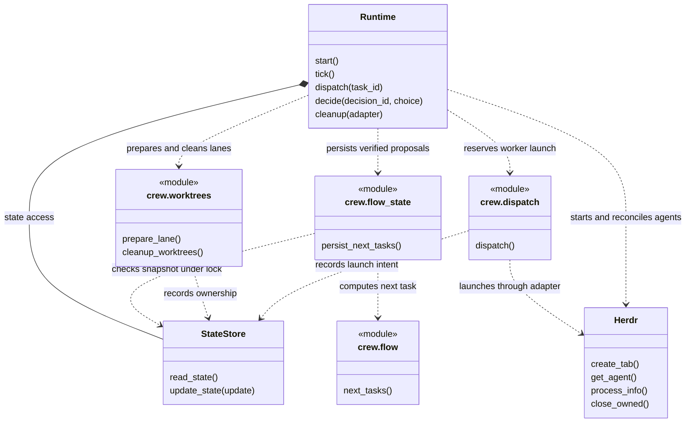

# Development

Read [release scope](remaining-scope.md) before you select work. The reduced release is accepted.
Define the behavior, files, acceptance checks, and applicable backlog condition for each new task.

## Environment

Set `crew_source` to your checkout path.

```sh
crew_source="/path/to/crew"
cd "$crew_source"
uv sync --locked --group dev
.venv/bin/python -m crew.cli --help
```

`pyproject.toml` and `uv.lock` specify Python and dependency requirements.
Sync can install the project and update build metadata. It is an environment setup operation.
See [setup](setup.md) for CLI availability in live Herdr panes.

## Code map

| Area | Files | Responsibility |
| --- | --- | --- |
| Configuration | `crew/config.py`, `defaults/` | Schema, duplicate keys, overlays, and references. |
| Flow | `crew/flow.py`, `crew/flow_state.py` | Steps, gates, decisions, and saved proposals. |
| State | `crew/state.py` | Locked state access and atomic replacement. |
| Launch | `crew/herdr.py`, `crew/launch.py`, `crew/dispatch.py` | Native identity, saved intent, and resource limits. |
| Completion | `crew/tick.py`, `crew/receipt.py` | Interactive evidence and oneshot exit receipts. |
| Resources | `crew/resources.py` | Memory, load, worker limits, quota, and queues. |
| Worktrees and controls | `crew/worktrees.py`, `crew/control.py` | Lane worktrees, ownership, and cleanup. |
| Integration | `crew/runtime.py`, `crew/cli.py` | Run lifecycle, controls, CLI output, and tick. |
| Verification | `tests/` | Temporary Git, fake Herdr, CLI subprocesses, and ownership tests. |

## Runtime structure

This UML diagram expands the [README overview](../README.md#operating-model).
Nodes with `module` expose functions. The other nodes are Python classes.
Solid composition shows the runtime's state store. Dashed arrows show calls or dependencies.



`next_tasks` reads supplied configuration, state, and verified evidence. It does no IO.
The bridge saves proposals under a state lock.
Runtime tick holds a separate runtime lock for controls, reconciliation, planning, and dispatch.
Runtime saves launch intent before the external Herdr operation.
The arrows show dependencies. They do not imply an atomic transaction across files or external processes.

## Work process

1. Read the accepted contract. Define a bounded change. Change an accepted module only for a demonstrated defect or an authorized requirement.
2. Assign one executor and an independent reviewer.
3. Use Sol 6.1 low for implementation. Use Sol 6.1 medium for review. Use Luna for smaller readonly tasks.
4. Use TDD to reproduce the requirement with a meaningful failing test. Make the smallest implementation change.
5. Do the targeted checks. After the process stops, execute the full suite. Resolve failures before further work.
6. Save commands, exit codes, source hashes, limits, and a handoff.
7. Review a stable source snapshot. Use fresh probes where necessary. After material changes, obtain scoped independent review.
8. Close only the accepted task. Record deferred work and its revisit condition in the [backlog](backlog.md).

The Lead supervises implementation. An executor report means ready for review; it does not mean independent approval.
Use existing valid evidence for an unchanged snapshot.

Keep one source writer per task slice.
Use Git status, diffs, and commit IDs to identify changes. Save source hashes with verification evidence.
Runtime lane worktrees do not isolate development of Crew itself.
Develop Crew in this checkout.

## Focused and full verification

Use the development environment and fresh temporary test roots. Select tests for the changed behavior.
This example selects cleanup tests:

```sh
crew_check_dir=$(mktemp -d "${TMPDIR:-/tmp}/crew-check.XXXXXX")
cd "$crew_source"

PYTHONDONTWRITEBYTECODE=1 .venv/bin/python -m pytest -q -p no:cacheprovider \
  --basetemp "$crew_check_dir/targeted" \
  tests/test_safe_cleanup.py tests/test_control.py tests/test_launch.py \
  tests/test_dispatch.py tests/test_worktrees.py tests/test_runtime_cli.py

PYTHONDONTWRITEBYTECODE=1 .venv/bin/python -m pytest -q -p no:cacheprovider \
  --basetemp "$crew_check_dir/full"
```

Record both exit codes and complete logs.
After the first process stops, resolve its failures. Then execute the second command.
Use temporary repositories and fake adapters.
Before changes to user repositories or live Herdr resources, obtain authorization for a separate validation task.

For ownership and control changes, cover these cases:

- Ownership mismatch causes no mutation.
- State changes during observation.
- External results are uncertain.
- Repeated operations retain correct ownership.
- Runtime retains the current caller.
- An exit receipt is missing.
- An active writer retains its worktree, even when Git status is clean.

Make sure that CLI output reports unresolved resources correctly.

## Build and verify a release

Build from a separate source copy. This prevents backend metadata writes in the reviewed tree:

```sh
crew_build_dir=$(mktemp -d "${TMPDIR:-/tmp}/crew-build.XXXXXX")
mkdir "$crew_build_dir/source"
cp "$crew_source/pyproject.toml" "$crew_build_dir/source/"
cp -R "$crew_source/crew" "$crew_source/defaults" "$crew_build_dir/source/"

uv build --wheel --out-dir "$crew_build_dir/wheel" "$crew_build_dir/source"
```

A normal build can download its backend.
For offline verification, use local dependencies and record their source.
The [acceptance record](release-acceptance.md) describes the verified local method.

Verify the installed wheel outside the source directory. Do these checks:

- Execute the generated CLI entrypoint.
- Import all modules.
- Inspect packaged defaults, prompts, and flows.
- Select the installed global directory explicitly.
- Repeat project initialization and confirm that it preserves a sentinel.
- Compare package hashes with the reviewed source.

A successful build alone does not establish installation or runtime behavior.

## Review and handoff

Record scope, changed files, model, native session, and context use where available.
Include before/final inventories, RED/GREEN exits, logs, independent verdict, retained resources, and pending actions.
Save a checkpoint before 35% context or 100K input. Keep each request below 130K context input.
When necessary, continue in a fresh session from the handoff.

Read [historical reports](evidence/2026-10-10/final-acceptance.md) as evidence for their recorded snapshot.
They do not authorize worker restarts or replace verification after code changes.

## Documentation changes

Use the [ASD-STE100 writing policy](documentation-style.md).
Update the applicable guide and links. For documentation tasks, preserve code, configuration, and defaults.
Validate links, command arguments, and status statements.
Record documentation inventory changes separately from the accepted executable snapshot.

Follow the [diagram instructions](../AGENTS.md#uml-documentation).
When a documented contract changes, update its UML diagram.
Validate diagram syntax and meaning. Mermaid blocks display in compatible Markdown viewers.
