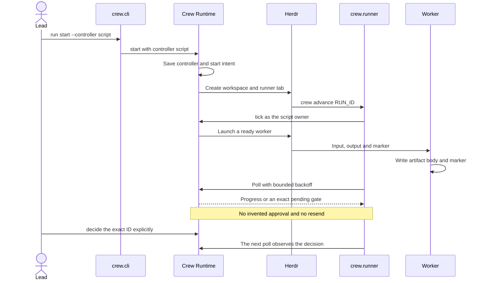
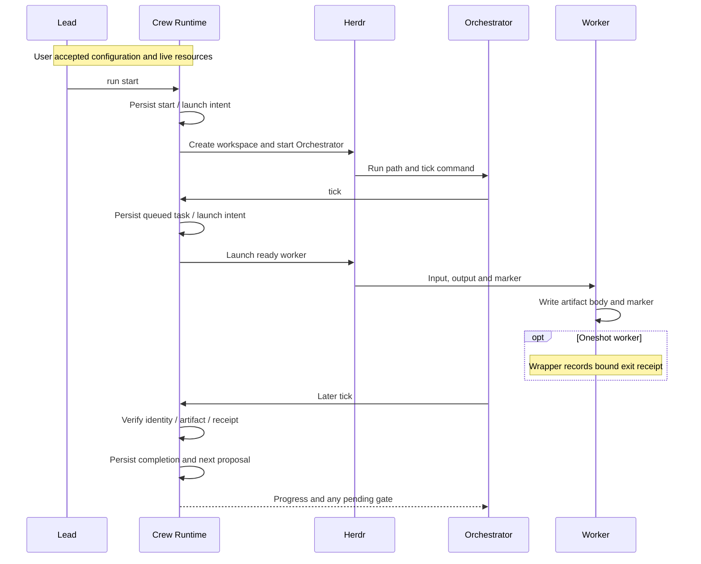
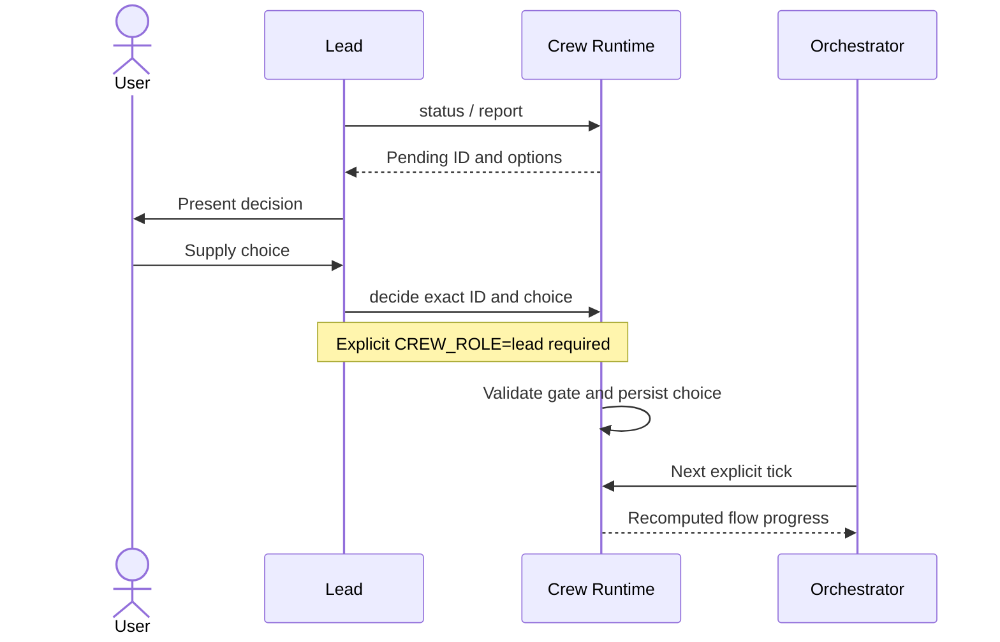

# Lead and Orchestrator workflow

## Lead

The Lead prepares configuration and presents it for user acceptance.
The Lead creates approved runs, reads status, and relays user decisions.
The Lead supervises implementation; workers change source and verify product changes.

Decision resolution requires `CREW_ROLE=lead`, the exact pending ID, and the user's choice.
Lead controls save pause, resume, stop, or close intent. The Orchestrator applies intent on tick.
See [getting started](quickstart.md) for commands.

## Orchestrator

One Orchestrator dispatches workers and advances each run.
Use Crew commands to change authoritative state. Do not write state files manually.
Dispatch, tick, and ask require `CREW_ROLE=orchestrator`.
The Orchestrator cannot approve its own decisions.

Explicit tick reconciles artifacts and receipts. It advances reachable flow steps and dispatches work when resources are ready.
Mutable workers use owned worktrees for each lane and repository.
Runtime records the base commit and launch directory. Mutable dispatch remains serialized.
Separate paths do not prove that changes can merge without semantic conflicts.

Report missing inputs, prerequisites, uncertain launches, and retained resources to the Lead.
Before a retry, inspect the uncertain identity.
Flow approval does not make unsupported external action roles executable.

## Script controller

A run can use a script controller instead of an LLM Orchestrator.
`crew run start RUN_ID --controller script` saves the controller choice with the start intent.
Runtime creates the workspace and starts one script runner in an unfocused Herdr tab.
The runner drives the same tick path.
It holds one run lock for its lifetime.
Manual `tick`, `dispatch`, and `ask` cannot compete with the script runner.
`crew advance RUN_ID` runs the runner in the foreground. Use it to recover a stopped runner.
Lead decisions and controls stay explicit. The runner observes them on its next poll.
Completion requires every run item flow complete after verified evidence.
A failure exits nonzero and stays visible. The runner does not dispatch a failed worker again.
A queued worker can wait on a resource or quota gate. Status shows the exact `resource_wait` reason.

The runtime self-calls use `StateStore`. The runner does not write state files directly.
The runner records `pid`, `status`, `reason`, `iterations`, `last_flows`, and `errors`.
A recorded `running` runner with a free lock is stale. Runtime records that recovery honestly.
A separate investigation covers shell readiness for agent start. Runtime does not retry it automatically.

## Workers

Workers receive input, output, and completion marker instructions.
Readonly workers inspect the project and write their assigned artifact.
Mutable workers change assigned source worktrees and write their assigned artifact.
Workers do not change authoritative run state.

Completion requires fresh owned output with a body and the configured marker on a separate line.
Oneshot tasks also require an exit receipt for the exact launch intent.
Preserve completed artifacts after validation.
Independent reviewers assess the evidence. Missing verification is not a pass.

## Run and decision sequence

These UML sequences separate worker execution from user decisions.
Each tick is an explicit Orchestrator command. A later tick verifies worker output.
The launch wrapper produces the oneshot receipt. The worker does not edit state to report its exit.

The persistence self-calls use `StateStore`. Agents do not write state files directly.
When a reachable flow step requires a user decision, use this sequence:

Missing prerequisites can keep dispatch queued.
Uncertain launch identity or invalid evidence blocks progress. There is no automatic launch retry.
A flow without a user gate omits the decision exchange.
Runtime denies decision resolution by Orchestrators and workers.
See [task lifecycle](runtime-cli.md#task-lifecycle) and [safe cleanup](runtime-cli.md#conservative-safe-cleanup) for control effects.

## Development staffing

Use Sol 6.1 low for implementation and Sol 6.1 medium for independent review.
Use Luna for smaller readonly tasks. These are staffing choices; defaults remain configurable.

Use bounded briefs and durable handoffs.
Save a checkpoint before 35% context or 100K input. Keep each request below 130K context input.
When necessary, use a fresh session. See [development](development.md).

## Ownership and external operations

Readonly instructions and tool gates are cooperative. They are not OS restrictions.
Agents must not answer permission dialogs or supply user choices.
Tracker writes, account changes, push/PR/merge, and topology/server operations require separate scope and authorization.

Pause and stop use cooperative controls.
The caller, active resources, uncertain resources, dirty worktrees, branches, and workspace shells can remain.
Read the reported cleanup result. A close request does not mean that every resource was removed.
