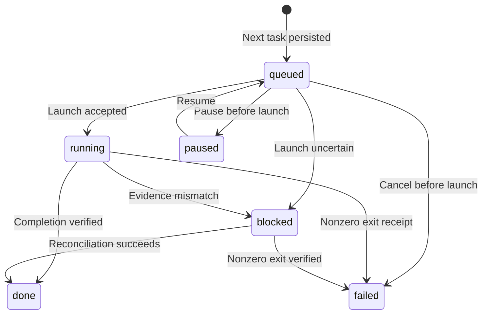

# Runtime and CLI

The noninteractive `crew` command calls the runtime modules.
From source, use `.venv/bin/python -m crew.cli`. A wheel installation supplies the `crew` entrypoint.
Global configuration defaults to `~/.config/crew`. Use `--global-dir` to select another directory.
Installed templates are under `share/crew`. Project settings are in `.crew/project.yaml`.
A run saves validated configuration in `.crew/runs/<id>/run.yaml`. State contains its digest.

`crew --help` lists commands. Bare `crew` shows local runs and next actions.
Output and errors use TOON on stdout.
Exit codes are 0 for success, 1 for runtime/configuration errors, and 2 for argument errors.
Read commands support `--fields`. Mutation commands reject `--fields` before changes.
`--full` shows authoritative state through status/report. `--toon` selects the default output format explicitly.
Identifiers permit ASCII letters, digits, underscores, and hyphens.

Examples:

```sh
crew project init
crew config validate
crew config set resources.max_workers=2 --scope project
crew run new --flow readonly --items DEMO --groups 1
CREW_ROLE=lead crew run start RUN_ID
crew status RUN_ID
CREW_ROLE=orchestrator crew tick RUN_ID
CREW_ROLE=lead crew decide RUN_ID DECISION_ID approved
CREW_ROLE=lead crew pause RUN_ID --team readonly
CREW_ROLE=lead crew resume RUN_ID --team readonly
CREW_ROLE=lead crew close RUN_ID --keep-worktrees
```

Initialization copies configuration and prompts without replacing existing files.
Run IDs can be explicit with `--id` or generated.
Configuration edits validate before replacement. Run edits require no prior start, tasks, or decisions.
Config/state replacement rejects a digest mismatch. Replacement is not an atomic transaction across both files.

Lead and Orchestrator roles can initialize runs and record controls.
Only explicit `CREW_ROLE=lead` can resolve decisions.
Runtime denies Orchestrator and unset roles before state access.
Dispatch, tick, and ask require `CREW_ROLE=orchestrator`.
Launches set `CREW_ROLE=worker` for workers and `CREW_ROLE=orchestrator` for the Orchestrator.
Role checks are cooperative permissions. They do not restrict arbitrary code with the same OS user.

## Tick and completion evidence

Tick uses a stable runtime lock to serialize runtime operations.
Dispatch preserves one launch intent. It does not retry uncertain launches automatically.
Interactive reconciliation compares native identity with the owned pane.
It uses a private copy of verified output. A guarded store compares state and artifact identity before commit.
The bridge verifies artifacts at lock entry and before persistence.

Artifacts must meet these conditions:

- The path matches the assigned item, flow, step, round, and role.
- The file is regular, has one link, and is not a symlink.
- The file stays inside the run directory.
- The file size is at most 1 MiB.
- The file is newer than launch.
- The content has a body and the configured marker on a separate line.
- After completion, the file keeps its saved fingerprint.

Unknown or changed evidence blocks progress. Restored native IDs must match exactly.
Runtime does not adopt another session automatically.

Oneshot launches use a wrapper that writes a private atomic exit receipt.
The receipt identifies the reserved launch intent.
A zero exit code and fresh owned output permit completion.
A nonzero exit code marks failure. A missing receipt leaves the task waiting.
The receipt helper does not let workers modify authoritative state.
File evidence and state cannot form one atomic transaction.
Independent tests passed; live process verification remains unperformed.

## Decisions and diagnostics

Flow decisions use the exact step/round ID and recomputed reachability.
Only `decide` approves a pending decision. `ask` records a stable pending question.
For a question, `decide` requires one listed option.

AXI installation reports configured commands and a user approval request. It does not execute an installer.
Doctor tests CLI availability and reads integration status.
Doctor reports restore settings and live smoke as unknown.

## Task lifecycle

This UML diagram shows the main changes to a task's saved `status`.
Task status differs from run completion and pane process status.
Launch intent, control flags, receipts, and cleanup records are separate fields.



Before-launch arrows require no reserved launch intent. Resume also requires no stop request.
Stop can cancel a never-launched `paused` task.
Unavailable resources keep tasks `queued`. Missing completion evidence keeps tasks `running`.
Nonzero receipt arrows apply to oneshot workers with an exact valid receipt.

Pause/stop on a launched task record cooperative intent.
They do not suspend or kill a process. They can require reconciliation.
A reserved launch without a confirmed result can stay `queued` with `reconciliation_needed`.
Runtime does not dispatch an uncertain launch again automatically.
Recovery from `blocked` requires valid ownership and applicable reconciliation guards.
It is not a general retry operation.

`done` or `failed` does not mean that resources were removed.
See [safe cleanup](#conservative-safe-cleanup) for removal conditions.

## Accepted release and limitations

The five-item [reduced release](remaining-scope.md) is independently accepted.
Recorded tests cover worktrees, cleanup, selected-run output, and packaging.
See [acceptance](release-acceptance.md), [backlog](backlog.md), [setup](setup.md), and [getting started](quickstart.md).
Replace RUN_ID and DECISION_ID with the selected run and exact pending ID.

- Live Crew dispatch/cleanup and real project/account E2E remain unaccepted.
- Tests used fake adapters, temporary Git repositories, and isolated real CLI commands.
- Mutable dispatch is serialized. Worktrees isolate paths but do not establish semantic merge compatibility or source conflict analysis.
- The executing caller, active panes, uncertain panes, branches, and workspace shells can remain after close.
- `--keep-worktrees` retains worktrees. Pause/stop send no interrupts. Agents do not answer dialogs.
- Runtime refuses push/PR/merge action roles even after flow approval. Tool-level enforcement of external writes is unimplemented.
- Event subscriptions, sidebar metadata, plugin/hooks, AXI home-view capture, and environment up/down execution are deferred.
- Automatic session adoption and a quota daemon are deferred. Explicit tick advances the run.
- Prompts contain input paths and prior verified artifact paths. Users must supply ticket files.
- Runtime does not read trackers or provision QA environments.
- Global/project edits replace files atomically but do not serialize concurrent editors.
- Strict YAML decoding rejects duplicate keys. Atomic config/state transactions remain outside scope.
- Artifact checks detect identity/content changes at defined points. Same-user mutations after the final check remain possible.
- The bridge's content comparison retains ABA and IO limits.

The original full plan and deferred backlog remain incomplete.

## Native worktree creation and launch

Readonly roles keep the project directory and permit projects without Git.
Mutable roles require Git repositories.
`repos: null` selects the project root. An explicit list must be nonempty.
Each entry must be a project-relative exact Git root; `.` is supported.
Absolute paths, traversal, symlinks, duplicate common Git identities, and non-repository directories fail.
Runtime does not adopt existing unowned worktrees.

Each mutable lane receives one worktree for each repository.
The first repository supplies launch cwd. Prompts list all assigned worktrees.
Items in the same lane share those worktrees.
During durable planning, `base_branch` resolves to a commit in each repository.
Without `base_branch`, runtime uses `HEAD`.
Unique `crew/<uuid>` branches start at those pinned commits.
Runtime does not copy uncommitted source changes.

`worktree_pattern` is a project-relative path.
Supported placeholders are `{run}`, `{lane}`, and `{repo}`.
`{repo}` is the configuration index: `repo0`, `repo1`, and so on.
The default is `.crew/worktrees/{run}/{lane}/{repo}`.
Runtime validates the complete plan before creation.
It rejects unsupported fields, absolute/escaping paths, symlinks, overlapping targets, occupied paths, and existing unowned registrations.
Absolute worktree patterns and the `{ticket}` field are unsupported.
That overlay needs an explicit migration. Runtime does not rewrite user overlays.

Lane records contain `launch_cwd` and `worktrees`.
Each worktree record contains repository path, common Git identity, base commit, owned branch, path, and creation status.
Common Git identity includes directory, device, and inode.
Ready records also contain worktree directory and Git administrative directory identities.
Before launch, task records contain `worktree_lane`, `worktrees`, and `launch_cwd`.
Worktree preparation can occur while unavailable resources keep the task queued.

Creation statuses are `planned`, `creating`, `ready`, and `uncertain`.
Runtime saves intent before `git worktree add`.
After a command error, reconciliation can record an exact owned registration that was created.
Without sufficient evidence, runtime retains uncertain records, paths, and branches.
Tick does not retry uncertain creation automatically.

Explicit `CREW_ROLE=orchestrator crew dispatch <run> <task>` permits a retry.
Only an exact saved branch/repository/path registration can be reused.
Ready identity mismatches fail. A branch without its exact worktree requires inspection.
Repeated dispatch preserves launch cwd and does not relaunch an existing launch intent.

Close can remove clean owned worktrees after process checks.
It retains branches and uncertain partial results.
Native worktree commands disable Git hooks and exclude inherited `GIT_*` overrides.
Runtime locks serialize Crew operations. External Git/filesystem changes and ABA races remain outside those locks.
Permissions remain cooperative.

## Conservative safe cleanup

Lead controls save intent. Orchestrator tick applies controls and reconciles completion.
Tick then repeats close checks for newly completed tasks.
Pause prevents dispatch without suspending processes.
Stop cancels never-launched tasks. Launched tasks stay active or uncertain until completion is proven.
A pane or missing receipt alone does not authorize a process signal.

Oneshot launch records `process_identity`, including `terminal_id` and `shell_pid`, when the Herdr boundary supplies them.
That boundary uses `pane get` and `pane process-info --pane`.
Missing evidence prevents cleanup.
Close requires these oneshot conditions:

- An exact fresh receipt with the matching exit code.
- Exact pane, tab, terminal, and shell identities.
- Only the saved shell in the foreground.

Orchestrator start saves mode and launch intent before launch.
It preserves known pane/session identity after an uncertain launch.
Exact idle/done native identity permits close, except for the caller in `HERDR_PANE_ID`.
Runtime always retains that caller. It does not destroy the containing workspace.

Close saves its attempt before Herdr mutation.
It does not repeat an uncertain external close without evidence.
After observation, runtime compares state, ownership, and intent again.
A changed launch identity prevents later automatic adoption.
Missing live identity permits another observation without resource mutation.

Worktree cleanup uses lane metadata, including preparation before resource queueing.
Every known launched process must be closed before removal.
An active or uncertain writer retains even a clean worktree.
Repository, common directory, path, administrative directory, registration, and branch identities must match.
Runtime retains symlinks, dirty/ignored content, changed HEAD, shared records, incomplete ownership, and uncertain creation.
Git removal uses no force. Runtime never deletes branches.

A saved removal attempt permits reconciliation only when the prior path, registration, and administrative directory are absent.
Runtime validates resources that reappear.
Runtime/state locks serialize cooperative state writers during removal.
External filesystem/Git changes remain outside those locks.

Tick saves `cleanup` in authoritative state.
Tick, status, and report show `active_tasks`, `orchestrator`, worktree reasons, `retained_branches`, `retained_resources`, `stopped`, and `closed`.
`stopped` requires all tracked launched processes to be closed.
`closed` also requires no retained worktrees, branches, workspace shells, or uncertain resources.
Retention is expected conservative behavior; it does not mean resources were destroyed.
Team close affects only its task panes. Worktree and Orchestrator cleanup require whole-run close.
